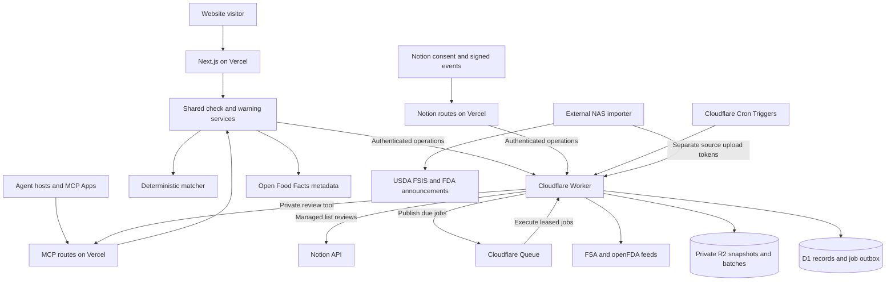

# Architecture

Updated: 15 October 2026. Cloudflare became the production backend on 14 October. [ADR 0002](adr/0002-migrate-backend-to-cloudflare.md) records the decision and trade-offs.

## Components and data flow

| Component | Responsibility | Implementation |
| --- | --- | --- |
| Next.js on Vercel | Website, deterministic checking, public/private MCP, Notion OAuth/webhooks and optional analytics forwarding | `src/app/`, `src/lib/`, `apps/eat-or-yeet/` |
| Cloudflare Worker | Authenticated operations and background-job execution | `backend/worker.ts`, `runtime.ts`, generated `api.ts` and `registry.ts` |
| D1 | Warnings, matching projections, ingestion state, metadata, quotas, shares, encrypted Notion connections and transactional job outbox | `backend/schema.ts`, `database.ts`, `migrations/` |
| Cloudflare Queues and Cron Triggers | Durable delivery, retries, expired-lease recovery and recurring maintenance | `backend/jobs.ts`, `wrangler.jsonc` |
| Private R2 | Temporary uploaded source snapshots and prepared import batches | `backend/incidents.ts`, `runtime.ts` |
| External NAS importer | Fetch and validate complete USDA FSIS and FDA announcement snapshots, then upload with source-specific credentials | `scripts/fsis-sync-worker.ts`, `deploy/fsis-sync/` |
| External APIs | Official warning sources, Open Food Facts metadata, Notion list access and opt-in PostHog capture | Source and integration modules under `src/lib/` and `integrations/notion/` |

Browsing current warnings is the main public flow; checking a pack is optional. The application uses no AI inference or photo uploads. Barcode detection runs in the browser, with manual entry as a fallback. Agent hosts use the same services and matcher as the website.

## State, transactions and jobs

D1 retains opaque record IDs and creation timestamps from the legacy backend. JSON records are validated through the domain schema, with SQLite expression indexes for declared queries. Public reads use compact warning projections rather than original source payloads. Public browsing uses a separate D1 projection, a regional ordering index, facet indexes and an FTS5 trigram index for the existing normalized substring search. Matching-row writes and derived index changes commit in the same guarded batch. Unchanged imports still skip writes. Trigger-maintained dirty markers prevent using an index changed by an older writer until it is rebuilt.

The website normally loads 40 browse rows with complete result/facet counts. Further pages use a first-party read endpoint with revision-bound, ten-minute cursors and eligibility-boundary checks. Filter requests are cancelled when superseded; a changed revision restarts the list visibly. Cache keys include backend URL, region, filters, cursor and dataset revision, with a one-minute TTL and explicit time-boundary checks. Food checks and MCP retain their existing source-health and food-only search contracts. During a backend rollout or index rebuild, the website can use the complete legacy regional-list path.

Queries bracket reads with a database revision. Mutations stage record changes and scheduled jobs, then commit one guarded D1 batch. A changed revision causes a retry. The global revision and single Queue consumer trade write throughput for simple consistency at the current workload.

The D1 outbox and domain writes commit together. Queue delivery uses a 20-minute lease and a claim token; stale deliveries cannot complete newer claims. A minute cron publishes due work and recovers expired leases. Failed jobs retry with bounded backoff, then remain failed for inspection. Acknowledged or queued work is not proof that a source import or Notion review completed. Third-party effects retain their own idempotency and lifecycle guards.

Source imports use private R2 batches of at most 25 notices. Each committed batch updates notices, projections, progress and continuation together. Successful objects are deleted. R2 lifecycle rules expire abandoned `source-imports/` objects after seven days and `fsis/` / `fda-announcements/` uploads after one day.

## Sources and freshness

Workers fetch FSA warnings and openFDA food/drug enforcement records. The NAS fetches USDA FSIS and FDA food/supplement announcements because those sources were unavailable or incomplete from hosted fetches. Both external imports run at startup, daily after success and hourly after failure; combined importer health requires both to succeed. See [source sync](usda-sync.md).

The production Worker schedules source refreshes at 04:17 UTC, temporary-data cleanup at 05:17 UTC, Notion cleanup at 05:23 UTC and product-category lookup hourly at minute 41. Snapshot-mode sources are excluded from hosted refreshes. Staging declares only the minute outbox/recovery cron and disables scheduled source refreshes and category lookups. These schedules come from `wrangler.jsonc` and `backend/jobs.ts`.

Food checks read source health on every request. A missing, failed, incomplete or older-than-48-hour source blocks a negative result. Revision-keyed persistent pages and the five-minute prepared matcher cache reduce repeated reads without extending source freshness. Medical browsing uses separately qualified FDA drug reports and does not contribute to food-check eligibility.

## Credentials and deployment boundaries

Vercel server routes use `BACKEND_URL` and `BACKEND_SECRET`; browsers never call authenticated Worker operations directly. Operator access and the two upload tokens are separate capabilities. Notion OAuth credentials are encrypted before storage; the encryption key must agree between Vercel and the Worker. Managed reviews use D1/Queues, not the NAS.

Local development runs Next.js with Wrangler and local D1/R2/Queue state, without a cloud account. Staging and production have distinct resources and secrets. Apply D1 migrations and deploy the compatible Worker before the Vercel application. `pnpm build:vercel` builds Next.js and its embedded MCP app only. There is no active Convex runtime or Vercel cron configuration.

The [deployment guide](cloudflare-deployment.md) covers commands, credentials, imports and rollback. The [cutover record](cloudflare-cutover-2026-10-14.md) contains dated migration evidence. Pre-migration usage reports are historical; [current cost guidance](cost-estimate.md) lists the measurements needed for this infrastructure. Live Notion acceptance on Cloudflare and physical camera tests are still unverified by the cutover record.
