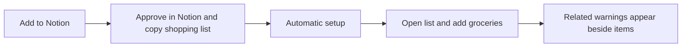

# Managed Notion installation

Updated: 10 October 2026

Decision: an ordinary shopper installs this through **Add to Notion**. Eat or Yeet hosts and operates the automation. The API-token, Docker and n8n instructions remain an optional maintainer/self-hosting runbook. This decision supersedes the earlier plan to offer owner-hosted automation as the normal customer installation.

Status: OAuth onboarding, managed operation, website entry and management are implemented on `codex/notion-installation` and tested locally. They remain default-off; the public OAuth/template installation and live multi-workspace acceptance gate have not run. [PR #7](https://github.com/anthonyhumphreys/eat-or-yeet/pull/7) supplies the deterministic review service and tested single-installation engine. It is an internal pilot, not a completed consumer integration.

## Customer flow

Show the explicitly selected UK/US warning country beside the entry button. Ask once if none is selected. Carry that choice through OAuth; browser locale can suggest it but cannot silently decide it. Do not ask where the shopper bought the food again. Retain country controls on the management screen.

The first release supports our supplied template. Notion's public OAuth flow can duplicate a public page, grant access to that copy and return `duplicated_template_id`. It also lets people choose existing pages instead. When no template was duplicated, show a helpful return to template installation; never scan the workspace or choose an arbitrary database. [Notion authorization and template installation](https://developers.notion.com/guides/get-started/authorization).

Use template duplication initially. It preserves the compact tested view and needs read/update capabilities for ongoing operation. Notion also documents automatic workspace-level database/view creation, which could remove the template choice, but adds insert capability and a newer API/version acceptance test. That is an alternative if real consent testing shows duplication causes friction. Do not implement both routes in the first release. [Programmatic onboarding](https://developers.notion.com/guides/get-started/preparing-for-users).

Show "Setting up your list" until the copied database, stable property IDs, credentials and durable processing are validated. Show "Reviews active" only after activation. On partial failure, resume the existing installation; a retry must not create a second list. The success screen opens the copied Notion list and links to management. It explains that item changes trigger reviews and that future-recall alerts are not yet included.

Keep the main template view to Item, Bought, Review status, Related warnings and Reviewed at. Hide optional packet fields and the technical fingerprint from that view. Do not prefill fake recalls or a reassuring example result. Existing custom lists can follow later with a picker and column mapping.

## Successor implementation PR

**Managed Notion installation and shopping-list automation** depends on PR #7. Keep OAuth, automatic list binding, tenant-safe processing, management and customer help in one complete feature PR. Splitting them would produce an installation that cannot review items or disconnect safely. Keep it default-off until the real installation tests pass.

| Part | Reviewable behaviour |
| --- | --- |
| Website entry and OAuth | Add to Notion, country summary, native consent, fixed callback URL, cancel/error handling and automatic return. Short-lived, single-use state is bound to a secure browser cookie; the country and intended operation are stored server-side. No tokens in browser storage, URLs, telemetry or logs. |
| Installation record | Store an internal installation ID, authorizing Notion user, workspace, bot, copied template page, database/data source, property mapping, region, lifecycle/generation and encrypted access/refresh tokens. Discover only beneath the copied page with bounded traversal. Validate actual types/IDs and the data-source/database relationship. Activation is atomic. |
| Managed processing | Verify the raw webhook once. Route using registered workspace and `accessible_by` bot recipients, then enforce the configured data source when fetching the row. Queue, deduplication, fingerprints, pauses and budgets belong to an installation. One active writer per data source prevents competing reviews. Keep existing bought/blank skips, result-edit filtering and fresh-input checks before each write attempt. |
| Credentials and recovery | Serialize refresh per installation and atomically replace the rotating access/refresh pair. Reauthorization verifies the original authorizing identity and updates credentials safely. Do not invent an expiry schedule when Notion supplies none. A revoked installation pauses without affecting others. |
| Management and disconnect | Use a scoped secure browser session for status, country, pause, reconnect and disconnect. Recover lost sessions through fresh Notion authorization; knowledge of a page/workspace ID does not confer control. Protect writes against CSRF. Disconnect disables the installation first, cancels work and removes retained credentials/state; revoke the Notion token where supported. Fence in-flight writes against disconnect/reconnect and wait for existing writes to finish before reporting disconnection complete. Preserve the shopper's list. |
| Customer documentation | Publish a short help page alongside the actual enabled entry button. Explain consent/access, fields reviewed, qualified results, delays/quota status and disconnect. Update privacy/support copy for service-held credentials. Show a clear unavailable state while the feature is disabled, without a nonfunctional install button. |

[Notion webhook recipients and delivery](https://developers.notion.com/reference/webhooks-events-delivery), [rotating token refresh](https://developers.notion.com/reference/refresh-a-token), [token revocation](https://developers.notion.com/reference/revoke-token).

No separate account/password system is required for the first version. The Notion authorization establishes ownership, and the service issues a browser management session scoped to that installation. Cross-device access requires a fresh authorization. Support one list per authorizing installation initially; reconnect should restore it without duplicating the template. Test Notion's repeated-authorization/template behaviour and provide an explicit recovery path before launch.

## Hosting and cost

Start with one bounded managed pilot on our existing NAS. Run one service and shared signed-webhook endpoint, with an installation metadata SQLite database and one durable SQLite queue per internal installation ID on a persistent private volume. Encrypt access/refresh tokens with a key outside the database. Backups must protect credentials too. Customers never operate this service. No polling of whole workspaces, paid model calls, per-customer containers or extra Convex writes for queue transitions.

The engine now supports embedded operation with per-installation queues and pauses, a credential provider for each Notion request, and readiness callbacks. The shared endpoint validates signed workspace/bot recipients; each worker checks its bound data source before reviewing a row. A bad schema or revoked connection pauses only that installation. Bound lists remain reserved through disconnect until active writes drain and local removal completes.

The current private MCP endpoint supports at most 20 static configured connection keys. Do not generate an environment key entry for every shopper. For the bounded pilot, use one operator service credential with durable per-installation budgets in the managed worker and an explicit shared MCP budget. Keep it server-only. Multi-process scaling needs shared quota enforcement and dynamic installation authentication or an authenticated service endpoint; a caller-supplied installation ID alone is not identity.

Defaults cap the pilot at 20 installations, 100 review admissions per installation per UTC day and 1,000 globally. Each queue holds at most 1,000 pending pages and 5,000 deduplication records. Two shared review slots and paced Notion requests bound in-flight work. Confirm these limits and the private MCP shared budget before enablement. Use fair scheduling and debounce to keep a busy list from starving others. Reuse regional snapshot caches. Idle installations cause no source queries. When limits are reached, show delayed/paused status and the next retry; never reuse a previous result as if it were a current review.

NAS hosting keeps the first pilot inexpensive but makes its availability, updates, private backups and restore testing our responsibility. A health check and operator alert are required. Measure per-review Notion/MCP traffic and remaining Convex/Vercel headroom on the managed pilot before broad enrollment. This change does not claim unlimited free installations.

## One-time operator setup

The [managed service runbook](./operators/notion-managed-service.md) gives configuration, deployment and rollback steps. These are our release tasks, not customer instructions:

- Register a dedicated public Notion OAuth connection with the intended workspace installation scope. Keep the approved private test connection separate. Marketplace listing is optional and has a separate submission process. [Public connections](https://developers.notion.com/guides/get-started/public-connections).
- Publish a clean shopping template containing no personal test rows or private identifiers. Configure its URL on the public connection.
- Configure the callback hostname, credentials, encryption key and private persistent storage. Set up one signed webhook subscription and HTTPS ingress. Customers do not register subscriptions or copy its verification token.
- Install the service, confirm quotas, private backups/restore and failure alerts, then run the acceptance tests. Enable the website entry only after this gate. No live public connection or template is created merely by merging the implementation.

## Acceptance and release gate

A shopper with an ordinary Notion account must finish installation and get their first real review using the website and native Notion consent screens alone. No developer portal, AI subscription, terminal, IDs or secrets in the customer flow.

Test two separate workspaces and two authorizing users in one workspace. Confirm token/row/event isolation, one active writer per list and that revoking one installation leaves the others working. Cover missing/altered templates, delayed readiness, consent cancellation, expired/replayed/mismatched OAuth state, duplicate callbacks, token refresh/rotation, reconnect, lost management sessions, country changes, failed sources, rate limits, restarts and disconnect during a review. A management-country change must invalidate pending generations and offer a bounded re-review of unbought items; old-country results must remain visibly dated until replaced.

Repeat the already-tested Milk/Oreo/Eggs creation/input-edit flow, bought-row skip and result-write loop check through the managed installer. Verify incomplete coverage stays "Unable to review", and a generic item's result never claims that the packet is safe. The live pilot from 10 October proves the existing engine, not these new OAuth/tenant controls.

Record actual Notion consent steps and API version in acceptance evidence. Only then call this a customer-ready Notion integration. Category watches and future-recall notifications remain a separate opt-in addition.

## Local verification evidence

The implementation tests exercise native OAuth requests and copied-template discovery, encrypted storage and quotas, real HTTP callback/session/webhook routes, and embedded multi-installation processing with real durable queues. Regression cases cover late 401s, token rotation, concurrent binding, completed pause versus delayed country changes, country-dependent fingerprints, and disconnect while a write is in flight. Notion and review responses are controlled fixtures in these tests. They do not prove real public consent, template duplication or webhook delivery. Record those results here before enabling the customer entry.
