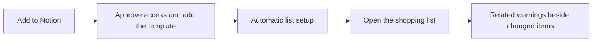

# Managed Notion installation

Updated: 11 October 2026

## Decision and status

The normal customer setup is **Add to Notion** on Eat or Yeet. Vercel runs the website, OAuth and webhook routes. Convex stores installation state and durable review jobs. Customers do not host a service, create API keys or need Notion AI.

The managed flow and local tests are implemented. The template is public and the OAuth connection is registered. Production testing is authorized with the flags enabled; the customer entry requires complete OAuth, backend and webhook configuration. Live acceptance remains a release gate. See the [readiness record](operators/notion-readiness.md). The deterministic review engine and optional standalone worker from [PR #7](https://github.com/anthonyhumphreys/eat-or-yeet/pull/7) remain useful for owner-run setups. They are not part of the ordinary customer flow.

## Customer flow

Use the user's saved warning country, or ask them to choose UK or US once. Carry that choice through OAuth and store it with the installation. Browser location may suggest a choice, but must not silently select a region. The header country control remains available.

The first release supports the supplied shopping-list template. Notion's public OAuth flow duplicates the published template and grants access to that copy. Only inspect pages and databases beneath the returned copy. If Notion returns no copied template, explain how to restart and choose it. Never scan a workspace or select an arbitrary database. [Notion authorization and template installation](https://developers.notion.com/guides/get-started/authorization).

Keep the main view to Item, Bought, Review status, Related warnings and Reviewed at. Optional brand, barcode and supported packet fields may narrow a review. Hide these fields and the input fingerprint from the default view. Do not seed a reassuring example result.

Adding or changing an unbought item creates a review job. Bought and blank rows are skipped. Result-only changes do not start another review. A generic item can match several products or batches; show the notice title, official source link, date and review time, then ask the shopper to compare their packet. A missing or stale source produces **Unable to review**. **No related warnings found in covered data** does not establish that food is safe. Future-recall monitoring and push notifications are not included.

## Same-app architecture

The browser starts OAuth at `/api/notion/connect?region=UK|US`. Vercel handles the fixed callback at `https://www.eatoryeet.app/api/notion/callback` and the signed Notion webhook at `https://www.eatoryeet.app/api/notion/webhook`. Management forms post to `/api/notion/manage`; reconnect uses the same connect route and the scoped management cookie to locate the existing installation.

Convex stores the installation owner, workspace, Notion bot and copied-list binding, region, lifecycle state, encrypted credentials, management sessions, event deduplication, review queue and bounded counters. The application encrypts OAuth credentials before storing them. The webhook queues work for changed pages in the registered list. Workers read only configured shopping properties, re-fetch current row data before writing, and update only dedicated review properties. They do not fetch full workspaces or page bodies.

Management shows setup and review status, warning country, retry timing, pause/resume, retry, reconnect and disconnect controls. Country changes schedule reviews for unbought rows. Pause and disconnect wait for in-flight work to drain. Disconnect then removes the saved connection and queue state, and revokes Notion access where supported. The list remains in the shopper's workspace. Status refresh is explicit; the page does not poll automatically.

The managed connection uses a server-only operator key for the private review tool. It is not exposed in the browser and is not provisioned per shopper. Do not use a Convex administrative credential as that key. Keep the public Notion OAuth client secret, credential-encryption key, webhook verification token and review key in the hosting secret store.

## One-time operator setup

These are release tasks for the service owner. They are not customer setup instructions.

- Register one public Notion OAuth connection for the customer flow. Set its redirect URL to `https://www.eatoryeet.app/api/notion/callback` and configure the intended workspace installation scope and content capabilities.
- Publish and configure a clean shopping-list template. Remove private test rows and identifiers. Verify the copied list has the database and fields the worker expects.
- Create the Notion webhook subscription at `https://www.eatoryeet.app/api/notion/webhook`, with the supported page-created and page-properties-updated events. Keep the verification token private.
- Set the OAuth client details, encryption key, webhook verification token, review key and `NEXT_PUBLIC_APP_URL` in the appropriate Vercel and Convex environments. Keep preview and production credentials separate. Configure the public app origin as HTTPS.
- Deploy Convex schema/functions before the matching Next.js version. Exercise consent, copied-template binding, signed webhook delivery and the first review on a controlled preview before general availability.

The Vercel/Convex deployment owns customer installations and queues. The NAS runs the separate USDA snapshot importer because USDA blocks hosted fetches; it does not host the managed Notion service. The [standalone Notion worker runbook](./operators/notion-shopping-worker.md) remains an optional owner-operated route.

## Acceptance and release gate

An ordinary Notion user must connect, receive the copied list and get a first real review through the website and Notion's consent screens alone. No developer portal, terminal, IDs or credentials should enter the customer flow.

Verify two separate workspaces and two authorizing users in one workspace. Confirm their sessions, credentials, rows, jobs, limits and controls stay isolated. Test consent cancellation, absent or altered templates, duplicate callbacks, expired or replayed OAuth state, token refresh, reconnect, lost management sessions, country changes, source failures, rate limits, restarts and disconnect during an in-flight write. Revoking one connection must not affect another.

Repeat the tested Milk, Oreo and Eggs input-change flow through the installer. Verify bought-row skips, result-write loop prevention, stale-source **Unable to review**, review limits and explicit refresh behavior. A generic item must never be described as safe.

Tests use controlled Notion and review responses. They do not prove live public consent, template duplication or webhook delivery. Record those results before claiming general availability. Category watches and future-recall alerts remain a separate opt-in feature.
