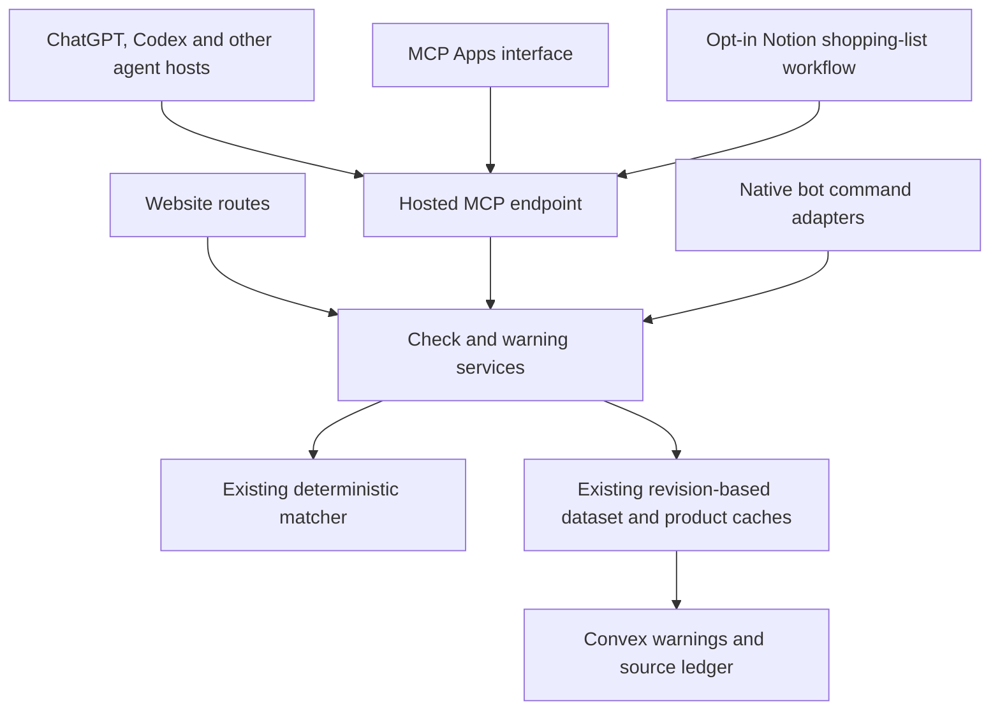

# Eat or Yeet agent and bot integration plan

Updated: 9 October 2026

Status: Implementation proposal. The existing website and cost optimisations are live. No MCP endpoint, plugin package, embedded interface, bot adapter, host connection or marketplace submission has been implemented or tested.

Build one hosted MCP service around the existing deterministic checker. Package it for ChatGPT and Codex, connect compatible agent hosts to the same endpoint, and add messaging bots as small channel adapters when there is demand. Keep the richer ChatGPT experience, Grok and Meta Muse as the proposed coordinated public launch. Broader client compatibility can be tested alongside that work; it does not require a separate backend for each provider.

The initial agent release should expose four read-only tools and a usable ChatGPT result/editor interface. Stage public sharing, Notion shopping-list reviews and native ChatGPT extensions as separate additions. Each has behaviour and compatibility requirements beyond the core checker.

## Scope and product behaviour

Support barcode checks, manual identifying details, warning search, warning details and source coverage for UK and US food. Region is required for checks and searches. Remember an explicitly chosen country within the current interaction; language, host location and browser locale may suggest a choice but must not silently select one. Do not require a second country-of-purchase question after the user has chosen the region. Retailer remains optional evidence when a warning makes it relevant. Country of origin is a separate packaging fact.

A useful barcode alone should trigger a check. Ask for batch, lot or date information only when it would resolve uncertainty. The service may enrich identity using the current curated product and Open Food Facts paths. Neither an unknown barcode nor the word "Oreo" establishes a complete identity match.

Keep all product-check decisions in the existing matcher. Hosts can put facts explicitly supplied by the user into tool arguments; they must leave unknown fields empty. Do not introduce model inference, photo extraction or uploads into Eat or Yeet. Camera scanning continues through the website. See [ADR 0001](./adr/0001-remove-ai.md) and [product principles](../PRODUCT.md).

The public result is qualified. Map internal `EAT` to "No matching warning found", never "safe to eat". Preserve possible matches, unresolved restrictions and `NO_CLUE`. A source-health failure must prevent reassurance. An infrastructure failure that prevents a check returns an error, not an invented verdict. Identity, batch and date restrictions must remain within the same affected product group.

Accounts, check history, general notifications, saved products, new countries and continuous recall monitoring are outside the core release. The Notion follow-up adds an opt-in review when someone adds or changes a shopping-list item. It does not promise to watch that item for future recalls. The host may retain conversation/tool data under its own policies; explain that boundary in the privacy page. Store no entered label details in logs, public shares or analytics.

## Host routes and distribution

The sources below were checked on 9 October 2026. They establish documented routes, not tested compatibility or access to our publishing accounts.

| Target | Implementation route | Distribution and acceptance gate |
| --- | --- | --- |
| ChatGPT and Codex | Hosted MCP, a portable Agent Plugins package and optional MCP Apps UI | Test a custom connection, then install the complete package. OpenAI public submission covers the shared plugin directory. Verify publisher identity, domain ownership and account permissions. [Packaging](https://developers.openai.com/plugins/build/plugins), [submission](https://developers.openai.com/plugins/deploy/submission). |
| Grok and Grok Bot | The same public HTTPS MCP endpoint | Custom connectors are documented. Business/Enterprise admin setup and Team Bots are team distribution routes; do not present them as an unrestricted public bot marketplace. Verify the actual installation route in our account. [Connectors](https://docs.x.ai/grok/connectors), [Team Bots](https://docs.x.ai/grok-bot/team-bots). |
| Meta Muse | Hosted MCP connector | Prepare the platform's connector submission and complete-workflow review. Confirm current intake and publisher eligibility before promising availability. [Connector guidelines](https://muse.ai/platform/docs). |
| Claude | Custom remote MCP connector | Test web/desktop setup and applicable workspace admin controls. Calls originate from Anthropic's cloud. Its API MCP connector is a separate beta integration route. [Custom connectors](https://support.claude.com/en/articles/11175166-get-started-with-custom-connectors-using-remote-mcp), [API connector](https://platform.claude.com/docs/en/agents-and-tools/mcp-connector). |
| Cursor | Remote MCP configuration or a plugin package | Provide a configuration recipe; public Marketplace distribution is a separate review. Validate portable packaging rather than assuming OpenAI-specific extensions work. [MCP](https://prod.cursor.com/help/customization/mcp), [plugins](https://prod.cursor.com/docs/plugins). |
| Gemini CLI and Gemini API | Remote Streamable HTTP MCP | Publish a CLI recipe. The Interactions API's remote MCP support is an application/API route, not a Gemini consumer chat listing. API callers pay their own model usage. [CLI](https://github.com/google-gemini/gemini-cli/blob/main/docs/tools/mcp-server.md), [API](https://ai.google.dev/gemini-api/docs/function-calling#remote-mcp-model-context-protocol). |
| n8n | MCP Client connected directly to Eat or Yeet | Provide one workflow example. An n8n server wrapper is unnecessary for consuming our tools. Check the installed node/version and credentials. [MCP Client](https://docs.n8n.io/integrations/builtin/core-nodes/n8n-nodes-langchain.mcpClient). |
| Notion shopping lists | Notion Custom Agent consuming our MCP tools, or a user-owned Notion API webhook workflow | Use native database triggers for a Custom Agent. Custom MCP connections require Business/Enterprise, supported connection authentication and agent credits. Offer a deterministic webhook/n8n recipe when those costs are unwanted. Notion's own MCP server does not provide a shopping-list change trigger. [Custom Agents](https://www.notion.com/help/custom-agents), [MCP connections](https://www.notion.com/help/mcp-connections-for-custom-agents), [webhooks](https://developers.notion.com/reference/webhooks). |
| Discord, Slack and Telegram | Native commands/webhooks calling the shared application service | Each channel needs its own installation, inbound authentication, retry and response handling. MCP does not replace these APIs. Start with Discord if a native bot is wanted; add other channels as separate follow-ups. [Discord commands](https://docs.discord.com/developers/interactions/application-commands), [Slack request verification](https://docs.slack.dev/authentication/verifying-requests-from-slack/), [Telegram Bot API](https://core.telegram.org/bots/api). |

Manual MCP connections and public listings are different deliverables. Record the tested host, client version, account tier, transport, UI support and installation path. Text-only operation is a valid baseline outside ChatGPT.

## Shared application services

Keep the current Next.js Node runtime, Vercel project, Convex backend and independent NAS USDA importer. Do not duplicate warning imports for integrations or expose the NAS to agent hosts. The MCP handler calls application services directly, avoiding a request back through `/api/check` and its browser cookies.

| Boundary | Existing implementation | Proposed change |
| --- | --- | --- |
| Check orchestration | `src/app/api/check/route.ts`, `enrichObservation`, `getCheckDataset`, `runMatcher` | Extract `src/lib/checks/service.ts`; keep cookie/network quotas, HTTP errors and the website response shape in the route. |
| Public contracts | `src/lib/domain/schemas.ts` and `types.ts` | Add `src/lib/integrations/contracts.ts` and `serialize.ts` with strict input/output schemas and a `contractVersion`. Do not change browser defaults to satisfy an agent contract. |
| Warning search/detail | `src/db/queries.ts`, `src/lib/incidents/browse.ts`, `public-source.ts` | Add `src/lib/incidents/search.ts`; reuse eligible public rows, category/retailer metadata and official-link validation. |
| MCP transport/tools | None | Add `src/app/mcp/route.ts` and small modules under `src/lib/integrations/mcp/`. Each handler validates, calls a service and formats a result. |
| Quotas | `src/lib/security/rate-limit.ts`, `convex/rateLimits.ts` | Add isolated integration budgets while retaining one atomic `takeMany` call. Reuse expiry cleanup. |
| UI/package | Website components only | Add an isolated embedded UI bundle and `plugins/eat-or-yeet/` with a portable manifest, MCP connection and checking/onboarding skills. |

Keep these as explicit functions and schemas. There is no need for a generic provider framework, model SDK or new database. A public REST/OpenAPI adapter is optional later, when a specific client cannot use MCP or an externally hosted bot needs it. It must call the same services and use scoped server credentials, never a public Convex administrative secret.

## Transport and SDK decision

Start the transport spike with `mcp-handler` 2.x, `@modelcontextprotocol/server` 2.x and the existing Zod 4. The adapter documents Web-standard Request/Response support and stateless fallback for 2025-era Streamable HTTP clients. The current MCP protocol uses per-request metadata and `server/discover`; exercise older `initialize` clients too. Do not build process-local session storage, Redis or legacy HTTP+SSE support. [Adapter](https://github.com/vercel-labs/mcp-handler/blob/main/README.md), [protocol compatibility](https://github.com/modelcontextprotocol/typescript-sdk/blob/main/docs/protocol-versions.md).

There is a current dependency mismatch: OpenAI's TypeScript MCP Extensions package peers on `@modelcontextprotocol/sdk` ^1.29.0 and `@modelcontextprotocol/ext-apps` ^1.7.5, while the current MCP Apps 2.x stack targets SDK v2. Use standard MCP Apps for the first UI. Gate sidebar, native settings, mentions and rich-form extensions on a supported dependency set and real client tests. Do not force peer overrides. If native extensions become essential before compatibility is available, evaluate an isolated v1 endpoint sharing the same services, including its migration cost and support window, before choosing it. [OpenAI peers](https://github.com/openai/mcp-extensions/blob/main/typescript/package.json), [MCP Apps SDK](https://github.com/modelcontextprotocol/ext-apps), [SDK support policy](https://github.com/modelcontextprotocol/typescript-sdk).

Before installing dependencies, recheck current versions and read the installed Next.js route documentation. Prove protocol discovery, schemas, POST responses, expected unsupported-method behaviour, origin/host checks, request deadlines and cancellation in the actual hosting runtime. Test both protocol generations without sticky routing. If the Web adapter fails, choose a supported adapter or a small separate Node service; do not cast Requests to Node IncomingMessage objects.

## Portable tools and output

| Tool | Input | Output |
| --- | --- | --- |
| `check_product` | Explicit UK/US region and bounded observation fields; barcode alone is valid | Public status/label/qualification, submitted evidence and separately identified enrichment, check time, current coverage, matched warning references, reasons, unresolved restrictions and truncation. |
| `search_warnings` | Region, optional bounded text/hazard/category/retailer filters, page size and opaque cursor | Public summaries, official and website links, current source status, total/continuation information and completeness. |
| `get_warning` | Public slug; continuation for affected groups when necessary | Consumer advice, affected product groups with their own codes/dates, authority, source and notice dates. |
| `get_coverage` | Region | Required sources, scope, status, last successful refresh and current health-check time. |

Require region instead of reusing `CheckRequestSchema`'s UK default. Reject unknown properties at every nested tool boundary. Normalise omitted optional fields to the existing empty observation. Use validated, unambiguous calendar dates for the public contract; ask for clarification rather than infer an ambiguous date. Preserve the existing browser's input behaviour.

Return concise text plus validated structured content. Use public slugs and ISO dates, and whitelist fields. Omit Convex IDs, original source payloads, internal scores that imply safety probabilities, cookies and secrets. Expose total match count when the matcher returns only its first ten results. Do not truncate a group's identifying codes away while leaving a misleading complete-looking match.

Declare reads and external access accurately. Barcode checks can contact Open Food Facts, even though they create no user check record. Internal cache/quota bookkeeping does not make a check a user-visible publication action. Keep malformed arguments, quota exhaustion, unavailable dependencies and domain inconclusiveness distinct. Returning no search results is never an authoritative product check.

### Search that is complete and bounded

The website currently traverses cached public dataset pages and filters the full regional list in memory. It has no indexed public search API. Reuse that complete eligible snapshot for the initial search service, filter before slicing, and share filter semantics with the website. Do not search just the first displayed page or pass a raw Convex cursor through filtered results.

Factor out the cached public-page snapshot loader, retaining start/expiry fields internally and omitting them from the public summary unless needed. Bind a signed opaque cursor to region, normalised filters, dataset revision, offset, `asOf` and expiry. Give it a maximum ten-minute TTL, shortened to the next notice start/end boundary in the snapshot. Reject expired cursors, changed filters or revisions with a recoverable restart response. Apply current eligibility boundaries on every request; a boundary crossing must restart pagination rather than shift an offset silently. Test this even when the dataset revision has not changed. Start with at most 20 summaries per page, a 200-character query and a 64 KiB serialised output target. Treat these as implementation limits to verify with real notices. Paginate large affected-group lists and report completeness explicitly.

Reuse revision-keyed pages; pass an already fetched version/status through the service rather than querying it twice. If full-snapshot filtering becomes too expensive in measured traffic, add a search projection/index in a later PR. Do not pre-emptively pay for another full table index or cache every arbitrary query indefinitely. Keep authoritative checking independent of any search scan budget.

## Anonymous access, privacy and cost controls

Public checking and browsing can start without user accounts. Declare anonymous access explicitly and verify each host's no-auth behaviour. Authenticated private features would require the host's supported MCP OAuth contract. Public sharing is a separate write decision. [OpenAI authentication guidance](https://developers.openai.com/plugins/build/auth).

Notion documents OAuth or API-key/bearer authentication for custom MCP connections. Do not assume the anonymous endpoint will work there. The Notion follow-up should support a revocable, connection-scoped read-only key with its own quota, provisioned privately for the pilot. Never put a shared key in a template or use a Convex administrative credential. This key authorises Eat or Yeet reads; Notion access and write permissions stay with the owner's agent or workflow. [Notion connection authentication](https://www.notion.com/help/mcp-connections-for-custom-agents).

Assistant calls often share cloud egress addresses and may not preserve browser cookies. A claimed host/user ID or MCP session ID is not an authenticated identity. Do not apply the website's anonymous-cookie quota as if it identified an assistant user. Use separate MCP operation buckets, a coarse trusted-network ceiling and a service-wide daily budget. Batch applicable counters in the existing atomic mutation; namespace them so exhausting the pilot budget does not exhaust browser buckets. All deployments still consume the same Convex team allowance.

The current server validators accept only `check`/`share`, and the TypeScript helper assumes anonymous/network scopes and hourly windows. Extend those validators and helper types backward compatibly for MCP operations, a global scope and daily windows. The existing table already stores action as a string, so this needs no extra index or duplicate table. Build the global daily key from a fixed MCP namespace and server-calculated UTC day, with short expiry; network buckets can remain hourly. Test atomic consumption across both windows and unchanged legacy website keys/counts. These controls limit integration work, but their enforcement still consumes shared Convex I/O and calls.

Apply the enable flag and cheap envelope/origin checks before application work. Allow documented server clients without an Origin header; reject invalid supplied origins and untrusted host/proxy claims. Bound tool arguments to the existing 16 KiB check budget, plus a separately bounded protocol envelope. Cap outputs, deadlines and concurrent expensive work. Fail closed when quota enforcement is unavailable. Use hosting ingress protection for discovery/resource abuse, while keeping ordinary discovery and static UI resource reads free of Convex calls. Worker-local counters are only supplementary protection.

Propose a small pilot budget of 1,000 checks per day across all MCP hosts, plus separately capped browse/coverage operations. At three Convex calls per warm barcode check, that permits roughly 90,000 monthly calls before cache misses and other operations. This is a ceiling, not predicted usage. Tune it after shared-egress tests and a normal production import cycle.

Retain the current product metadata cache, revision-keyed persistent warning pages and bounded prepared matcher cache. Check source health and current notice boundaries on every product check. Do not cache final verdicts across health changes. The 48-hour freshness gate, daily official refreshes and NAS USDA sync remain unchanged.

The latest samples demonstrate cheaper warm requests and repeat imports, but there is no measured free-tier capacity for agent traffic yet. October I/O is already above the included allowance. Before broad publication, measure ordinary daily imports, the weekly archive-check cycle, cold/warm checks, search CPU and Vercel active CPU. Include protocol/discovery and embedded UI requests in hosting usage. Retain 20% operating headroom or agree a small overage budget separately. See [usage and capacity estimates](./convex-usage.md).

Log operation, latency, result category, dependency failures and aggregate quota/cache metrics. Do not log barcodes, observations, share handles, protocol bodies or personal identifiers. Redact provider/HTTP error bodies too. Disable verbose adapter logs in production. Publish short-lived quota identifiers and retention rules in the privacy policy. No paid analytics service, Redis instance, always-running bot process or model inference is required for the first release.

## ChatGPT interface and package

Use standard MCP Apps resources and the host bridge. Keep every tool useful without rendering. Start with a compact result and an editor for missing evidence; extend to warning detail and coverage views. Reuse brand tokens and presentational primitives, while keeping website navigation, cookies and data-fetching hooks outside the bundle. Version UI resource URIs and use a minimal CSP. A shared protocol does not establish UI support in each host: require actual ChatGPT rendering tests and retain text-only Codex/other-host operation unless their UI is verified. [MCP Apps UI guidance](https://developers.openai.com/plugins/build/chatgpt-ui).

The result shows the server-produced label, region, check time, coverage and official advice. Evidence editing keeps the previous result visibly tied to the previous input until a fresh check succeeds. Opening or remounting a component must not automatically check a product or publish a share. Send committed result summaries/public warning references to model context, not every draft keystroke. Persist harmless preferences only, with no check-history list.

Include invalid barcode/date, unknown product, missing evidence, checking, warning/possible match, qualified no match, stale/missing coverage, dependency error, quota limit and interrupted-request states. Test narrow/wide layouts, light/dark, keyboard focus, screen readers, long codes and several affected groups. Keep a website fallback when UI is unavailable.

Package `plugins/eat-or-yeet/plugin.json`, `mcp.json`, checking/onboarding skills and brand assets using the portable Agent Plugins schemas. Put OpenAI presentation fields under `extensions.com.openai`. Validate referenced paths and build a reproducible credential-free ZIP. Include exactly one remote MCP URL in the first submitted package. Local registered-app mappings are testing configuration; exclude `apps`/`.app.json` references and lifecycle hooks from the public submission ZIP because the current submission flow rejects them. [Package format](https://developers.openai.com/plugins/build/plugins), [submission restrictions](https://developers.openai.com/plugins/deploy/submission).

Native sidebar/panel entrypoints, settings, public-warning mentions, deep links and richer forms are an optional subsequent PR after the SDK gate clears. Feature-detect capabilities. Composer mentions are desktop-only in current guidance, and extension availability varies by plan/client. Keep region/edit controls in the portable UI as fallbacks. [Extensions](https://developers.openai.com/plugins/build/extensions).

## Separate additions

### Notion shopping-list recall nudges

Start with an explicitly selected shopping-list database, one UK/US region and an item-name property. Support optional brand, barcode and packet-detail properties, plus a bought/archived flag. A plain checkbox list in a page is a later compatibility task. Review new items and relevant input changes; skip blank or already bought items.

For a generic item such as "milk", show related published warnings and ask the shopper to check the packet. Example copy is "Related UK milk warnings found. These affect specific products and batches; check the brand and packet details." Include actual notice titles, official links, dates, source coverage and the review time. This is discovery, not a product verdict. A row update creates an inline nudge; it does not guarantee a Notion push notification.

Add a read-only `review_shopping_items(region, items[])` tool in this follow-up, with at most 20 bounded items per call. Load the regional snapshot and current source health once per batch. Use deterministic product-name/category relevance and a small tested alias list. A chocolate recall for undeclared milk must not appear merely because the user added milk. Existing broad categories and full-text hazard matches are insufficient. Return the relationship reason, a bounded set of links and a continuation path. Unknown terms or unavailable coverage return an explicit incomplete review. Supplied brand/barcode details can narrow discovery. Offer `check_product` as a separate explicit packet-check action, preserving unresolved batch/date restrictions; do not write a product verdict into the shopping-list row.

Write only dedicated result properties, such as "Related warnings", "Review status" and "Reviewed at". Keep the shopper's item, quantity and bought flag intact. Use qualified states such as "Related warnings found", "No related warnings found in covered data" and "Unable to review". Never label a generic shopping item safe. Forward only the configured item fields to Eat or Yeet, not the page body or unrelated workspace content.

There are two installation routes:

- **Native Notion Custom Agent.** Configure a page-added or relevant-property-change trigger on the selected database, consume Eat or Yeet MCP and write results through Notion's native tools. Notion triggers start the run; MCP does not. Limit the agent's writable destinations and review its tool permissions during setup. The owner pays any Notion agent credits; Eat or Yeet still runs no model. Test the actual plan, administrator settings and supported key authentication before offering this recipe. [Triggers](https://www.notion.com/help/custom-agents), [custom MCP permissions](https://www.notion.com/help/mcp-connections-for-custom-agents), [credits](https://www.notion.com/help/buy-and-track-notion-credits-for-custom-agents).
- **User-owned webhook workflow.** Provide a deterministic n8n recipe for an owner willing to run it. Subscribe to Notion API page-created/property-updated events, verify the raw request signature, fetch the current row, call the same review tool and update result properties. Tokens stay in the owner's secret store. Grant access only to the selected database and the content capabilities needed for existing-row updates. This avoids model credits but still has hosting and maintenance costs. Use API webhooks rather than assuming an installed n8n Notion Trigger is webhook-based. [Webhook verification](https://developers.notion.com/reference/webhooks), [event delivery](https://developers.notion.com/reference/webhooks-events-delivery), [capabilities](https://developers.notion.com/reference/capabilities).

For API webhooks, inspect changed-property IDs and ignore result-only updates. Custom Agent documentation does not establish filtering by which property changed; require a tested input-fingerprint/status guard that prevents writeback loops. Use the deterministic workflow if native-agent execution cannot meet that gate. Debounce edits, deduplicate event IDs and unchanged inputs, fetch the latest row after delayed events, and discard results if relevant inputs changed during the request. Bound concurrency, respect Notion rate-limit retries and retain only minimal deduplication state for the retry window. Stop cleanly when access is revoked or the configured properties disappear. [Notion request limits](https://developers.notion.com/reference/request-limits).

Reuse regional revision caches and deduplicate identical items within a batch. Check current health and notice eligibility on every review, including cache hits. Apply connection and global integration budgets, with bounded batch size included in quota accounting. Prefer the deterministic route for recurring lists when the owner already runs n8n; measure actual credits per item before recommending the native agent for frequent use. A future opt-in refresh when warnings change needs a separate budget and subscription design. Do not poll whole workspaces or create a managed Notion OAuth/token-storage service for this first follow-up.

### Explicit public sharing

Add `create_public_share` only after confirming each release host's write/auth and approval behaviour. OpenAI recommends authentication for write actions; our current browser uses a short-lived signed capability rather than an account. Establish whether the proposed sanitised anonymous publication is acceptable before exposing it through an installed plugin. The read-only release remains useful while that decision is unresolved.

Reuse the existing 15-minute signed result capability and 24-hour public expiry. Treat a share handle as authority to publish only that fixed sanitised snapshot, never arbitrary model-supplied result copy. Reject `NO_CLUE`, invalid/expired handles and unrequested publication in host/UI flows. A model-supplied `confirmed: true` is not proof of user approval.

Add atomic retry idempotency in `convex/shares.ts`, scoped to the validated capability and an idempotency key. Store only a keyed digest, public share ID and expiry, with existing temporary-data cleanup. Do not store the handle or entered evidence. Retries return the same link. Mark the tool as a write and use an explicit UI action/host approval; check/search tools never create a share automatically. Keep the browser share path compatible and test lost-response retries.

### Native messaging bots

Start with `/check region:US barcode:044000061494` and warning/coverage commands. Use deterministic command fields and follow-up controls; there is no need to buy a model to interpret free text. Provide an optional-field form for label details. Default to private/ephemeral replies where the channel supports them; do not broadcast entered details or send unsolicited alerts.

For Discord, use an HTTP interactions endpoint, verify signed raw requests and application identity, handle PING, and respect initial-response deadlines with the supported deferred-response lifecycle. Avoid a Gateway process and broad message-reading permissions. Deduplicate interaction IDs with short-lived records. Verify retry handling and completion within the host lifecycle before shipping; do not depend on fire-and-forget promises. [Discord interactions](https://docs.discord.com/developers/interactions/receiving-and-responding).

Slack needs its own signed-request/timestamp checks, installation credentials, acknowledgement and response flow. Telegram needs its webhook secret and update-ID deduplication. Each adapter uses verified platform identity for hashed per-user/workspace quotas and calls shared services directly when hosted in the same app. Retain credentials in deployment secret storage. If delayed jobs require temporary entered evidence, specify and disclose a short processing TTL before adding durable storage. [Slack verification](https://docs.slack.dev/authentication/verifying-requests-from-slack/), [Telegram webhooks](https://core.telegram.org/bots/api#setwebhook).

## PR split and sequencing

Use four core PRs with complete, reviewable outcomes. Keep the transport experiment inside the MCP PR, and combine implementation, tests and relevant docs in each PR. Do not create separate PRs for each tool, schema file, quota helper, manifest or copied host recipe. Split again only if a concrete independent behaviour or review size warrants it.

| PR | Scope and reviewable result | Dependencies and release behaviour |
| --- | --- | --- |
| 1. Shared services and public contracts | Extract check orchestration, add whitelisted output mapping and strict agent schemas, implement complete cached warning search/cursors, and add parity/grouping/search tests. Website check responses, errors and quotas remain compatible. No public endpoint yet. | First. Merge independently; no new public behaviour or provider account required. |
| 2. Hosted MCP with bounded anonymous access | One `/mcp` endpoint with all four read tools, protocol-generation support, input/output validation, isolated atomic quotas, limits, redacted metrics and a default-off `MCP_ENABLED` flag. Include Inspector/transport tests and a live custom ChatGPT smoke test. | PR 1. Spike adapter/SDK compatibility first, then finish this vertical slice. Keep production's flag unset; disabled handling precedes discovery/work. Enable only on the controlled development/preview pilot. No separate quota follow-up that would leave an unprotected endpoint. |
| 3. Portable ChatGPT UI and installable plugin | Inline result/evidence editor, warning and coverage views, static bundle/resources/CSP, checking/onboarding skills, portable manifest, ZIP validation and host/UI tests. Test installation in ChatGPT and Codex with a text-only fallback. | PR 2. Keep package and UI together so the installed plugin is testable. Include no unsupported native extension shim or public sharing tool. |
| 4. Host compatibility and release preparation | Actual Grok/Muse pilot checks, Claude/Cursor/Gemini/n8n recipes and smoke results, privacy/support documentation, review cases, walkthrough/package tooling, measured capacity report and rollback runbook. Record Notion's authentication/plan requirements and manual core-tool compatibility if available; its shopping-list workflow belongs in the follow-up. Small necessary compatibility fixes belong here with their tests. | Start documented client checks after PR 2; finalise after PR 3. Parallelise host validation and submission preparation. Provider permissions/review waits are tracked release tasks, not empty code PRs. |

PRs 1–3 form a dependency chain. PR 4 can proceed alongside UI work once the tool contract is stable. Keep dependent branches based on the preceding branch, retarget/rebase after it merges, and describe each PR's own delta. Do not make a giant cross-platform PR or break up tightly coupled safety work just to reach a line-count target.

Follow-up PRs are independent additions, not prerequisites for the read-only launch:

| Addition | PR boundary | Depends on |
| --- | --- | --- |
| Notion shopping-list nudges | Deterministic related-warning service and batch read tool, scoped connection-key authentication, shopping-list template, native-agent and webhook/n8n recipes, quota accounting and relevance/loop/retry tests in one feature PR. Keep writeback and Notion credentials in the owner's workflow. | PR 1 search/check services and PR 2 MCP/quotas; verified Notion connection and trigger behaviour. A managed multi-user Notion app is separate later scope. |
| Public sharing | Capability-backed write tool, atomic idempotency, cleanup, host approval/auth verification and UI button with regressions in one PR | PR 2; UI portion after PR 3; resolved host write/auth gate |
| Discord bot | Commands, verified webhook, deferred completion, deduplication, channel quotas, installation docs and tests in one PR | PR 1 services and established integration quota patterns |
| Slack or Telegram | One PR per requested channel because installation, trust and reply semantics differ | Shared services and quota patterns; no need to wait for Discord |
| Native ChatGPT extensions | Sidebar/panel entrypoints, settings and supported mentions/forms with capability fallbacks in one cohesive PR | PR 3 and verified SDK/client compatibility; split a form feature only if it changes the transport |
| External REST/OpenAPI adapter | Versioned transport over the same services, scoped authentication and contract tests | A concrete non-MCP client requirement |

Expect roughly two engineering weeks for the core services, MCP, UI and host QA, with transport/search complexity as the main uncertainty. Notion shopping-list reviews, native bots and public-write support add scope. Marketplace reviews, publisher verification and the SDK gate do not have a dependable completion date. Re-estimate after PR 2's transport and usage measurements.

## Verification and release gates

Each implementation PR runs lint, type checking, focused unit tests and a production build. Run the full unit/browser suite when shared website behaviour changes and before release. Audit newly introduced production dependencies and document any outstanding findings rather than claiming an unrelated existing advisory is fixed.

Use account-free local Convex and deterministic source fixtures for ordinary tests. Keep demo data out of public listings. Host tests use a private tunnel or controlled preview with deliberately current source status; do not enable daily imports on every cloud preview. [OpenAI connection testing](https://developers.openai.com/plugins/deploy/connect-chatgpt).

The regression matrix covers:

- Oreo barcode `044000061494` in US, using fixed product/source fixtures and a qualified unmatched result when appropriate. Test barcode-only checks and expired/unknown metadata; no fallback to an unhelpful form solely because optional fields are absent.
- A known recalled barcode, including `100001000297` in the recorded FDA fixture, plus missing/matching/wrong batch/date restrictions. Do not require a historical recall to remain active in the live source forever.
- Unknown barcode, insufficient evidence, ambiguous dates and attempts to combine evidence across affected groups.
- Missing/stale/failed source coverage with warm caches, dependency outages, revision changes, notice start/expiry boundaries and cold page failures.
- Search matches beyond the first page, complete pagination, cursor tampering/filter changes/revision expiry and large grouped details.
- Cookie-free/shared-egress calls, quota exhaustion, fail-closed counters, protocol generations, cancelled work, remounts and duplicate requests.
- Actual installed host tool selection, region clarification, qualified copy, official advice links and unsupported UI fallback.
- For the Notion follow-up, generic milk versus allergen-only milk mentions, brand/barcode narrowing, UK/US separation, stale coverage, blank/bought rows, batch limits and duplicate items. Test input edits during a run, duplicate/out-of-order events, result-write loops, revoked keys/access, property renames and rate-limit retries. Verify that only configured input fields leave Notion and only dedicated result properties change.

For OpenAI review, prepare five positive cases covering barcode-only checking, a grouped restriction clarification, complete warning search/detail, coverage and evidence editing. Prepare three negative cases for an unknown identity, stale coverage and attempts to publish or infer safety without a supported authorised action. Supply an accessible walkthrough, release notes and any required test credentials privately. Complete domain verification at the portal's challenge URL. [Review requirements](https://developers.openai.com/plugins/deploy/submission).

Prepare complete primary-platform integrations in parallel and retain the proposed coordinated ChatGPT/Codex, Grok and Muse announcement. OpenAI and Muse require their documented submission/review paths. Grok's release deliverable is a tested manual/custom or team-managed MCP installation guide; no third-party public connector directory or listing approval has been established. Actual installation availability is a gate for each route. There is no cross-provider atomic publish operation. If publisher access or intake blocks a primary host, resolve the release scope explicitly before announcing a date; do not invent a listing or describe custom/team setup as a public marketplace release.

Deploy additive Convex changes before Next.js. Confirm live source health, a known fixture/live warning, Oreo checking, trusted proxy behaviour and measured resource use. Enable the MCP pilot independently from the website. Disable it through `MCP_ENABLED` if its quotas, errors or cost exceed the agreed budget; preserve website checks and source refreshes. Give native bot adapters their own enable switches. Keep the canonical submitted MCP URL stable; OpenAI's current update flow does not support self-serve URL changes. [Submission/update flow](https://developers.openai.com/plugins/deploy/submission).

The next implementation task is PR 1. Its concrete acceptance result is shared-service parity with the current checker, strict public schemas and complete revision-aware search, with no new publicly reachable integration.
